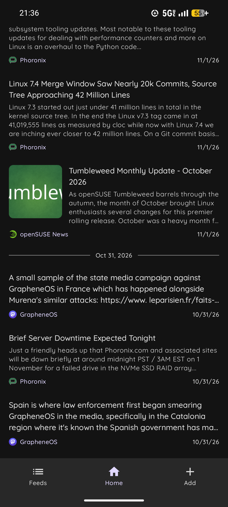
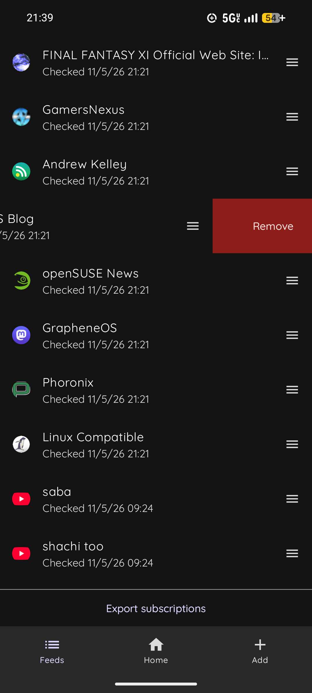
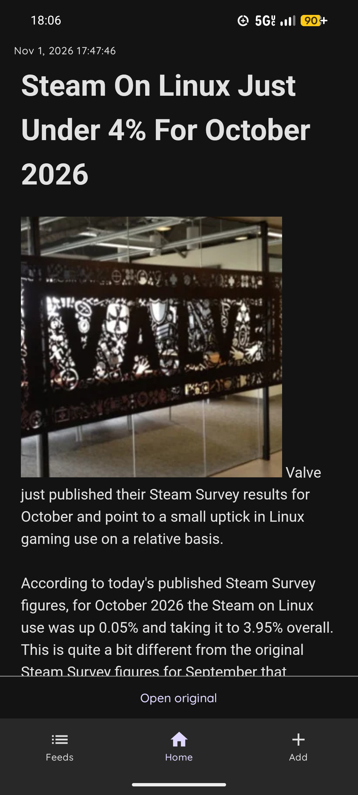

<h1 align="center"> ThresholdRSS</h1>

A simple RSS and Atom reader for Android.

|  |  |  |
| ---------------------------------------------- | -------------------------------------------- | ------------------------------------------- |

## Features

- RSS 2.0 and Atom.
- OPML import and export.
- View the combined feed or an individual feed.
- Material You themed.
- No account, no sync, no telemetry.

## Build

Requires JDK 21 and the Android SDK with platform 37.

```sh
./gradlew assembleRelease
```

The APK is written to `app/build/outputs/apk/release/`.

## License

GPL-3.0. See [LICENSE](LICENSE).
